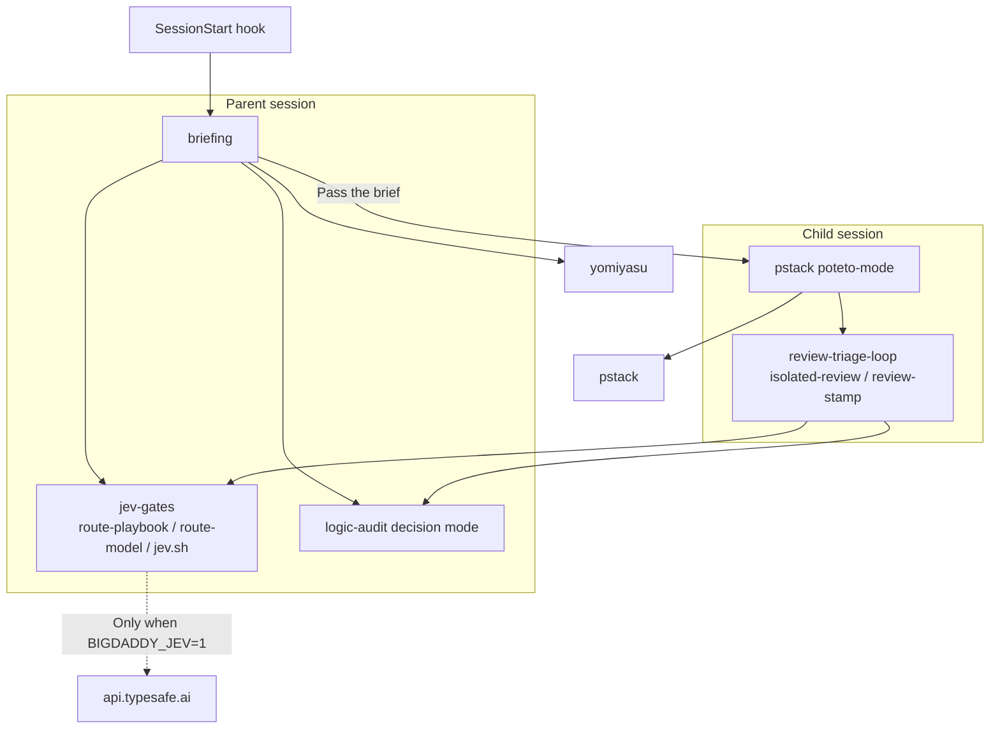
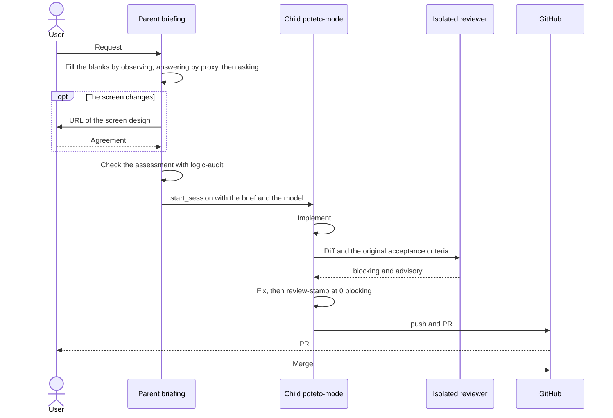
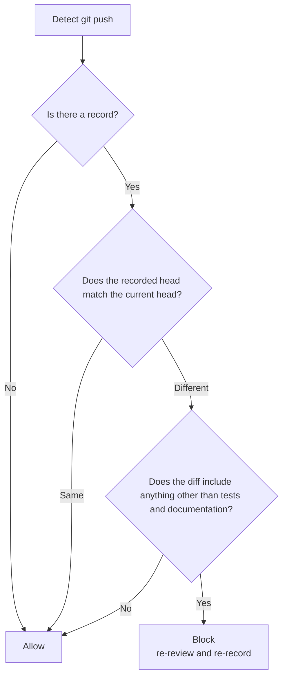
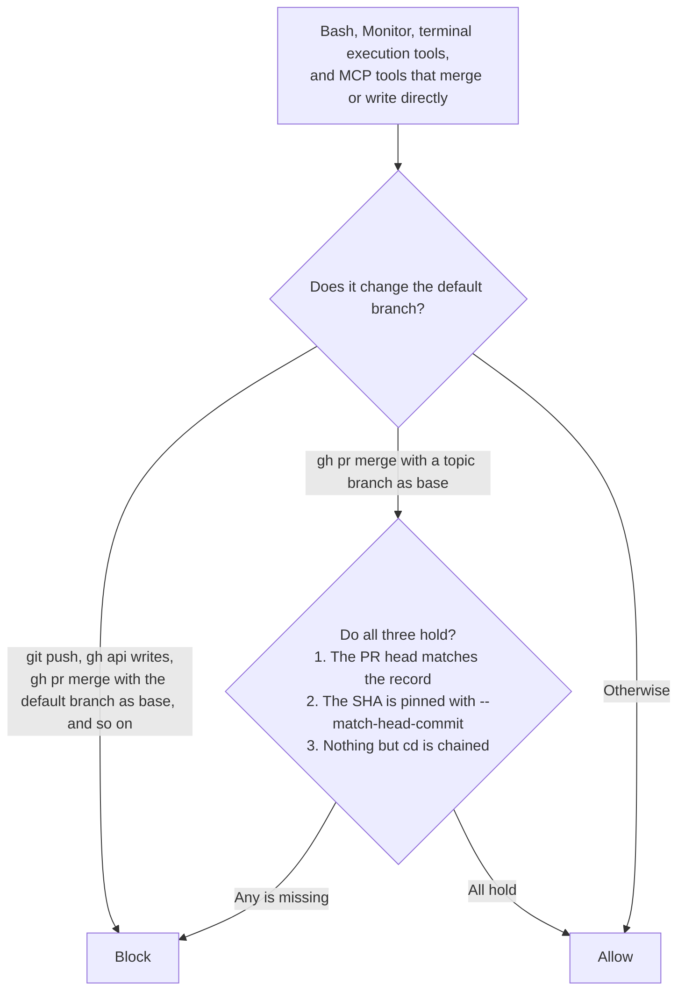
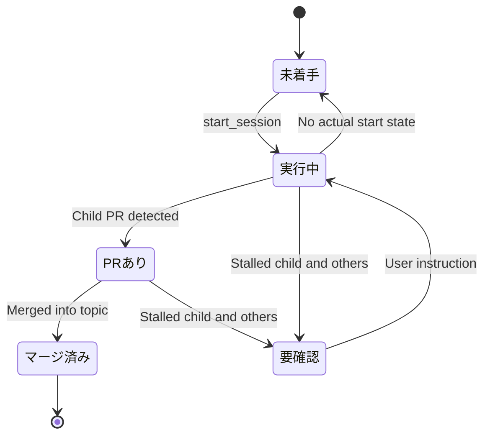

# Internals

This page describes which components hold which state on the way from a request to a PR, and where each one stops. For usage, see the [README](../README.md). For the list of rules, see [Workflow](workflow.md).

## Components and where they live

bigdaddy is made of three kinds of parts: prose (skills), scripts, and hooks. Judgment goes in prose. Mechanical processing that must be reproducible goes in scripts. Actions that must be stopped go in hooks.

| Kind | Location | Role |
|---|---|---|
| Skill | `plugins/bigdaddy/skills/<name>/SKILL.md` | Steps that the agent reads. Supplements are in `references/` and executable scripts are in `scripts/` |
| Hook | `plugins/bigdaddy/hooks/` | `hooks.json` binds them to Claude Code events. They stop actions without asking in prose |
| Model table | `plugins/bigdaddy/pstack-models.md` | The model and effort for each pstack role. The user copies it to `~/.claude/rules/` |
| Cloud Setup | `cloud/setup.sh` | Puts the same setup in cloud sessions, which do not read the local `~/.claude` |
| Dependencies | `.claude-plugin/marketplace.json` | Pins pstack and yomiyasu by sha and installs them together with bigdaddy |

pstack and yomiyasu are only called as parts. bigdaddy holds none of their contents. pstack skills cannot be started with the Skill tool, so the agent reads `SKILL.md` with the Read tool. `skill-read-guard` blocks the workaround of reading it with Bash.

## Skill dependencies

An arrow points in the direction of a call that names the target in a procedure. `agent-reasoning-playbook` is not called by any other skill. The agent reads it on its own.



## Flow of a single brief



### What the parent fills in

The blanks of a brief are the items in `plugins/bigdaddy/skills/briefing/references/brief-template.md`. briefing does not hand over a brief until all of them are filled. The blanks are filled in the following order. If an earlier method fills a blank, do not move to the next.

1. Observe. Look at the code, logs and git history. Do not ask about what observation can reveal.
2. Answer by proxy. If `~/.claude/bigdaddy/proxy-answers.md` exists, read it first. Otherwise read `references/proxy-answers.md`.
3. Ask. Ask only about preferences and specifications, one to three questions at a time, each with a recommendation.

The playbook is chosen by `route-playbook.sh` from options it builds each time from the poteto-mode list. The main model of the implementation session is chosen by `route-model.sh --session <playbook>`, and Jev is not called. Feature and Refactoring use `sonnet high`. The others use `opus medium`.

### Escalation from child to parent

The child asks the user only the four items in the "本人に必ず返すもの" section of `briefing`. For a design choice that goes beyond the brief, the child sends the ones that match (a) to (d) below to the parent with `SendMessage`.

| Mark | What matches |
|---|---|
| (a) | Changes the means of getting from "now" to the "desired state" |
| (b) | Affects other briefs or the overall policy |
| (c) | Differs from the screen design |
| (d) | A blocking finding from the second or later isolated review. The child does not fix it and sends the full text of the finding |

A local choice that matches none of these is decided by the child and written in the "判断の記録" section of the PR body.

## Isolated review

The reviewer is a fresh agent, separate from the implementer. It does not receive the implementer's design notes or reasons for decisions. It receives only the original text of the acceptance criteria and invariants, and the diff, so that the same misreading is not repeated.

| Round | Scope | What it returns |
|---|---|---|
| 1st | The whole diff | blocking, advisory |
| 2nd and later | Only the diff from the head reviewed last time | blocking only |

From the second round on, the child does not fix blocking findings and sends them to the parent. The parent sorts them into "Fix", "Do not fix" and "Separate PR". The child fixes only those marked "Fix" and submits the next round. If findings appear twice in a row around the same area, the parent decides whether to move that part to a separate PR.

When blocking reaches 0, `review-stamp.sh` writes the SHA of that head, per branch name, as one line to `$(git rev-parse --git-common-dir)/bigdaddy/review-stamps/<branch>`. The location is the shared git directory, not each worktree, because a branch name is unique across the whole repository.

## Hook decisions

Every hook takes the basis for its decision from the command string, the git state and record files, not from prose.

### Before a push



What is compared are the current branch and the recorded branch named in the command. Documentation is limited to `README`, `CHANGELOG`, `LICENSE`, `CONTRIBUTING`, Markdown files under the root `docs/` and `doc/`, and `.rst` and `.adoc` files.

### Merges to the default branch

`topic-merge-guard` derives the default branch from the repository. For git it uses `origin/HEAD` as the target, and otherwise `gh repo view`. If it cannot derive the default branch, it blocks.



What it cannot stop is indirect execution through script files, aliases and variable expansion, and writes that are not in its list, such as `gh repo edit`. The guard targets an agent's misunderstanding and overeagerness. It does not assume an agent that evades it on purpose.

## Topic state

When there are two or more briefs, the state is kept outside the conversation. The source of truth is one JSON under `## 指示書の状態` in the body of the final PR (draft). Only the parent rewrites it. If the parent is closed, work can continue from the same JSON.

```json
{
  "topic": "topic/<slug>",
  "design": null,
  "briefs": [
    {"id": "<slug>-01", "depends": [], "state": "未着手", "session": null, "pr": null,
     "qa": "未", "card": null, "started_at": null, "reason": null}
  ],
  "qa": "未実施",
  "reason": null
}
```



Each time it wakes up, before making any decision, the parent compares the actual state (branches on origin, `gh pr list`, `list_sessions`, `git log`) with the table. If they differ, it treats the actual state as correct and rewrites the JSON. If it finds any of the following, it sets the row (for a QA blocking, the overall `qa`) to "要確認" and returns to the user. It does not fix them automatically.

- A stalled child. At least 3 hours have passed since the last update and the session is not running. Or the child reported completion but its child PR is not merged into the topic.
- A QA blocking.
- A conflict that even a resolution child cannot settle.
- A mismatch between the table and the actual state that cannot be fixed uniquely from the actual state.
- A comparison result that does not determine a single next action.

Keeping the topic up to date with the default branch is the parent's job. It does not rebase or force-push. Before starting a new child (only when the default branch has advanced) and right before QA (every time), it runs `git merge origin/<default branch>` in a temporary worktree. The parent does not resolve conflicts. It adds a resolution brief as a new row.

## Jev

Jev is disabled by default, and `jev.sh` is the only thing that reaches outside. Unless `BIGDADDY_JEV=1` is set, it calls nothing and returns exit 3, and each skill proceeds with its steps that do not use Jev.

| Exit code | Meaning |
|---|---|
| 0 | The call succeeded. The output is only answers |
| 1 | HTTP failure |
| 2 | No key |
| 3 | Disabled (`BIGDADDY_JEV=1` is not set) |

Only when Jev is enabled, the following two hooks run.

- PostToolUse `decision-audit-nudge.sh` prompts a check in decision mode right after `jev.sh`, `route-playbook.sh` or `check-naze.sh` is run. It does not call Jev.
- Stop `decision-audit-stop.sh` shows the body of that turn to Jev once. If the turn has a decision that needs a check but no check was done, it blocks once per turn. It does not block when the Jev key is missing or the call fails.

## How models are chosen

The pairs of model and effort are fixed to three.

| Layer | Pair | When it is used |
|---|---|---|
| collect | `haiku high` | Collect facts |
| organize | `sonnet high` | Organize what was collected |
| decide | `opus medium` | Choose and decide |

`route-model.sh` judges the layer with Jev. When confidence is low, it falls back to the next higher layer. Failing on a cheaper model and redoing the work costs more in the end. `CLAUDE_CODE_SUBAGENT_MODEL=sonnet` affects only subagents started without `model`.

## Where state lives

| State | Location | Who writes |
|---|---|---|
| Brief | Prompt of `start_session` | Parent |
| Topic state | JSON in the final PR body | Parent only |
| Head that passed isolated review | `<git-common-dir>/bigdaddy/review-stamps/<branch>` | Child (`review-stamp.sh`) |
| Decision record | The "判断の記録" section of the PR body | Child and parent |
| Default proxy answers | `~/.claude/bigdaddy/proxy-answers.md`, or `references/proxy-answers.md` if it does not exist | User |
| Model table | `~/.claude/rules/pstack-models.md` | The user copies it with `cp` |
