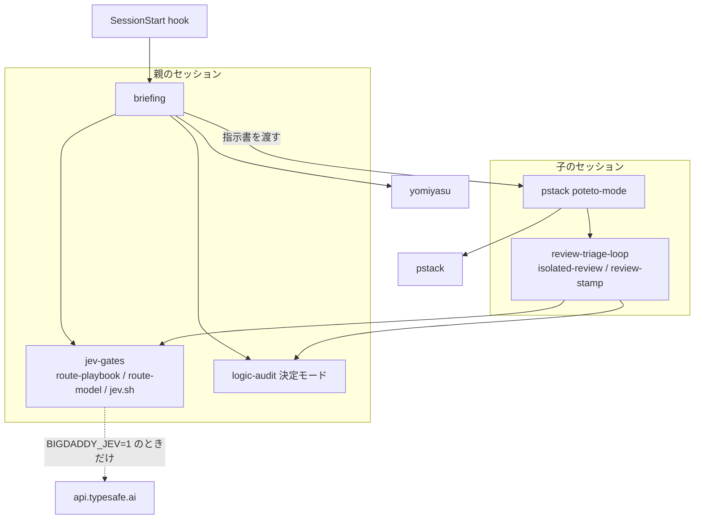
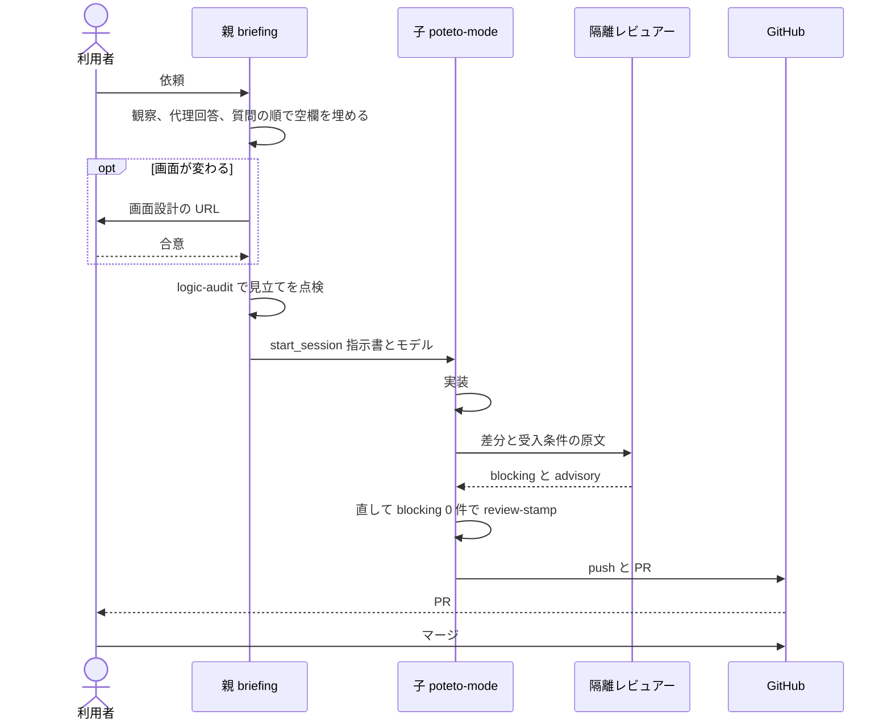
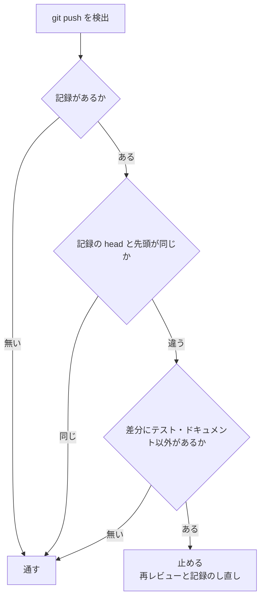
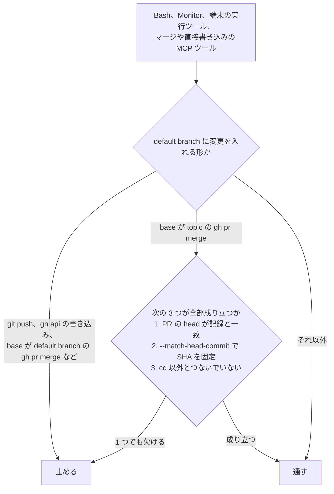
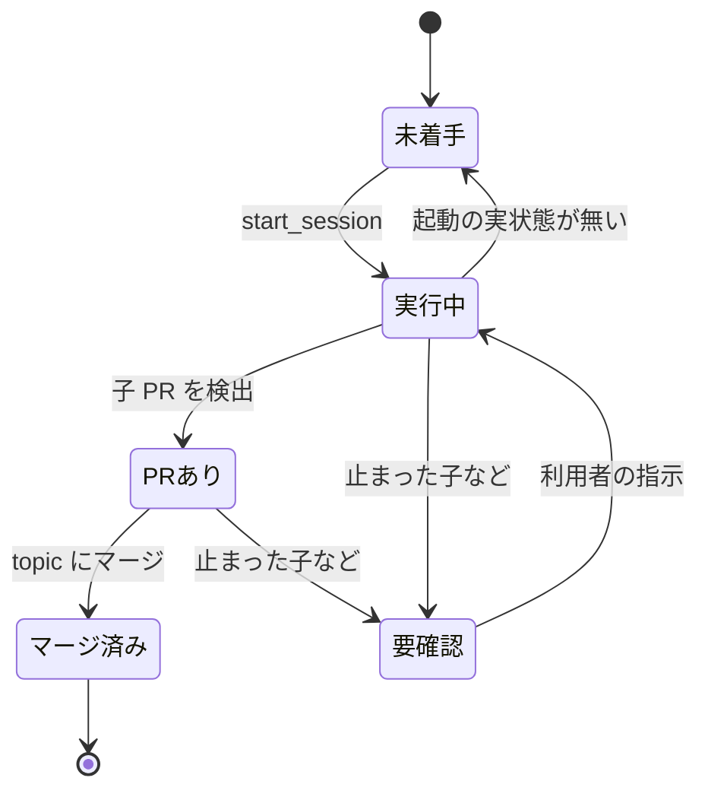

# 内部の仕組み

bigdaddy が依頼を PR にするまでに、どの部品が、何を状態として持ち、どこで止まるかを書く。使い方は [README](../README.md)、規則の一覧は [作業の流れ](workflow.md) にある。

## 部品と置き場

bigdaddy は文章（skill）、スクリプト、hook の 3 種類でできている。判断は文章に、再現させたい機械的な処理はスクリプトに、止めたい動作は hook に置く。

| 種類 | 場所 | 役割 |
|---|---|---|
| skill | `plugins/bigdaddy/skills/<名前>/SKILL.md` | agent が読む手順。`references/` に補足、`scripts/` に実行するスクリプトを持つ |
| hook | `plugins/bigdaddy/hooks/` | `hooks.json` が Claude Code のイベントに結びつける。文章で頼まずに止める |
| モデル表 | `plugins/bigdaddy/pstack-models.md` | pstack の役割ごとのモデルと effort。利用者が `~/.claude/rules/` に写す |
| クラウドの Setup | `cloud/setup.sh` | 手元の `~/.claude` を読まないクラウドセッションに、同じ構成を置く |
| 依存 | `.claude-plugin/marketplace.json` | pstack と yomiyasu を sha で固定して、bigdaddy と一緒に入れる |

pstack と yomiyasu は部品として呼ぶだけで、bigdaddy は中身を持たない。pstack の skill は Skill ツールで起動できないので、agent は `SKILL.md` を Read ツールで読む。`skill-read-guard` が、Bash で読む抜け道を止める。

## skill の依存

矢印は、手順の中で名前を挙げて呼ぶ向き。`agent-reasoning-playbook` はほかの skill から呼ばれず、agent が単独で読む。



## 1 枚の指示書の流れ



### 親が埋める項目

指示書の空欄は `plugins/bigdaddy/skills/briefing/references/brief-template.md` の項目で、briefing は全部埋まるまで渡さない。埋め方は次の順で、前の手段で埋まれば次に進まない。

1. 観察する。コード、ログ、git の履歴を見る。観察で分かることは聞かない。
2. 代理で答える。`~/.claude/bigdaddy/proxy-answers.md` があれば先に読み、無ければ `references/proxy-answers.md` を読む。
3. 聞く。好みや仕様だけを、1 回に 1 から 3 問、推奨を付けて聞く。

プレイブックは `route-playbook.sh` が、poteto-mode の一覧から毎回作った選択肢で決める。実装セッションの主のモデルは `route-model.sh --session <playbook>` で決め、Jev は呼ばない。Feature と Refactoring は `sonnet high`、それ以外は `opus medium`。

### 子から親への返し

子が利用者に聞くのは `briefing` の「本人に必ず返すもの」の 4 項目だけ。指示書の外に出る設計の選択は、次の（a）から（d）に当たるものを `SendMessage` で親に返す。

| 記号 | 当たるもの |
|---|---|
| （a） | 「今 → 望む状態」に至る手段を変えるもの |
| （b） | 他の指示書や全体の方針に影響するもの |
| （c） | 画面設計との差 |
| （d） | 2 回目以降の隔離レビューで出た blocking。子は直さず、指摘の全文を送る |

当たらない局所的な選択は、子が決めて PR 本文の「判断の記録」に書く。

## 隔離レビュー

レビュアーは実装役と別の fresh な agent で、実装役の設計書や判断理由は渡されない。渡すのは受入条件・不変条件の原文と差分だけで、同じ読み違いを繰り返さないため。

| 回 | 見る範囲 | 返させるもの |
|---|---|---|
| 1 回目 | 差分全体 | blocking、advisory |
| 2 回目以降 | 前回レビューした head からの差分だけ | blocking だけ |

2 回目以降の blocking は、子が直さずに親へ送る。親が「直す」「直さない」「別 PR」に仕分け、「直す」と返したものだけを子が直して次の回にかける。同じ周辺に 2 回続けて出たら、親がその部分を別 PR にするか決める。

blocking が 0 件になったら `review-stamp.sh` が、その head の SHA をブランチ名ごとに `$(git rev-parse --git-common-dir)/bigdaddy/review-stamps/<branch>` に 1 行で書く。置き場が worktree ごとではなく共通の git ディレクトリなのは、ブランチ名がリポジトリ全体で一意だから。

## hook の判定

hook はどれも、判断の根拠を文章ではなく、コマンドの文字列、git の状態、記録ファイルから取る。

### push の前



比べるのは、いまのブランチと、コマンドに名前が出る記録済みのブランチ。ドキュメントは、`README`・`CHANGELOG`・`LICENSE`・`CONTRIBUTING`、ルートの `docs/` と `doc/` の下の Markdown、`.rst`・`.adoc` に限る。

### default branch へのマージ

`topic-merge-guard` は、default branch をリポジトリから求める。git の送り先は `origin/HEAD`、無ければ `gh repo view`。求められないときは止める側に倒す。



止められないものは、スクリプトファイル経由、alias、変数展開などの間接実行と、`gh repo edit` のような列挙に無い書き込み。守る相手は agent の勘違いと先走りで、意図的に回避する agent は想定しない。

## topic の状態

指示書が 2 枚以上のとき、状態は会話の外に置く。正本は最終 PR（draft）の本文にある `## 指示書の状態` の JSON 1 つで、親だけが書き換える。親を閉じても、同じ JSON から続けられる。

```json
{
  "topic": "topic/<slug>",
  "design": null,
  "briefs": [
    {"id": "<slug>-01", "depends": [], "state": "未着手", "session": null, "pr": null,
     "qa": "未", "card": null, "started_at": null, "reason": null}
  ],
  "qa": "未実施",
  "reason": null
}
```



親は起きるたびに、判定の前に実状態（origin のブランチ、`gh pr list`、`list_sessions`、`git log`）と表を照合し、食い違えば実状態を正として JSON を書き直す。次のどれかを見つけたら、該当の行（QA の blocking は全体の `qa`）を「要確認」にして利用者に返す。自動では直さない。

- 止まった子。最終更新から 3 時間以上たち、セッションが動いていない。または、終了を報告したのに子 PR が topic にマージされていない。
- QA の blocking。
- 解消の子でも収まらないコンフリクト。
- 表と実状態の食い違いを、実状態から一意に直せない。
- 照合の結果から、次の動作を 1 つに決められない。

topic を default branch に追従させるのは親の仕事で、rebase と force-push はしない。新しい子を始める前（default branch が進んでいたときだけ）と、QA の直前（毎回必ず）に、一時 worktree で `git merge origin/<default branch>` を実行する。コンフリクトは親が解かず、解消の指示書を新しい行として足す。

## Jev

Jev は既定で無効で、外部に出るのは `jev.sh` だけ。`BIGDADDY_JEV=1` でなければ何も呼ばず exit 3 を返し、各 skill の Jev なしの手順で進む。

| 終了コード | 意味 |
|---|---|
| 0 | 呼び出しに成功。出力は answers だけ |
| 1 | HTTP の失敗 |
| 2 | 鍵が無い |
| 3 | 無効（`BIGDADDY_JEV=1` でない） |

有効のときだけ、次の 2 つの hook が働く。

- PostToolUse の `decision-audit-nudge.sh` は、`jev.sh`・`route-playbook.sh`・`check-naze.sh` を実行した直後に、決定モードでの点検を促す。Jev は呼ばない。
- Stop の `decision-audit-stop.sh` は、そのターンの本文を Jev に 1 回見せ、対象の意思決定があるのに点検が無ければ、1 ターンに 1 回だけ止める。Jev の鍵が無いときや失敗したときは止めない。

## モデルの決め方

モデルと effort の組は 3 つに固定している。

| 層 | 組 | 使う場面 |
|---|---|---|
| collect | `haiku high` | 事実を集める |
| organize | `sonnet high` | 集めたものを整理する |
| decide | `opus medium` | 取捨選択して決める |

`route-model.sh` は層を Jev で判定し、確度が低いときは一段上の層に倒す。安いモデルで失敗して手戻りすると、かえって高くつくため。`CLAUDE_CODE_SUBAGENT_MODEL=sonnet` は、`model` を付けずに起動した subagent だけに効く。

## 状態の置き場

| 状態 | 置き場 | 書く人 |
|---|---|---|
| 指示書 | `start_session` のプロンプト | 親 |
| topic の状態 | 最終 PR 本文の JSON | 親だけ |
| 隔離レビュー済みの head | `<git-common-dir>/bigdaddy/review-stamps/<branch>` | 子（`review-stamp.sh`） |
| 判断の記録 | PR 本文の「判断の記録」 | 子と親 |
| 代理回答の既定 | `~/.claude/bigdaddy/proxy-answers.md`、無ければ `references/proxy-answers.md` | 利用者 |
| モデル表 | `~/.claude/rules/pstack-models.md` | 利用者が `cp` する |
