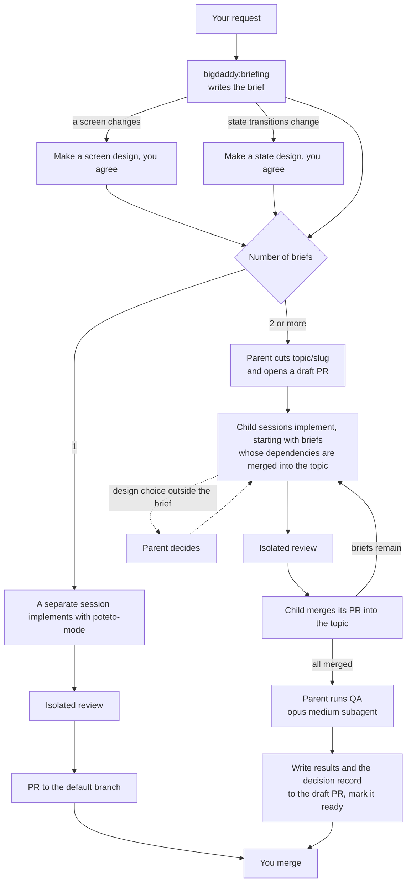

# Workflow

The rules and the skill roles from a request to a returned PR. The overview is in the [README](../README.md).

## Overall flow

## Rules

- The front half (turning a request into a sufficient, essential brief) is `bigdaddy:briefing`. The back half (implementation) is pstack's `poteto-mode` in a separate session.
- Almost every pstack skill (all but `setup-pstack`) is `disable-model-invocation: true`, so the model cannot start it with the Skill tool. It reads `SKILL.md` with the Read tool and follows it. You type `/pstack:<name>`. bigdaddy skills and yomiyasu use the Skill tool.
- For large work (two or more briefs), the parent cuts `topic/<slug>` from the default branch (for example main), and the child sessions merge their isolated-review-passed PRs into the topic themselves. When the parent cuts the topic, it opens a draft PR from the topic to the default branch. The dependencies of each brief (including briefs that touch the same file) go in the draft PR, and only briefs whose dependencies are all merged into the topic start. When all children are merged, the parent runs QA with an opus medium subagent. The parent writes the result and the children's "判断の記録" (decision records) into the draft PR and marks it ready. You check only that PR and merge it. With one brief, there is one PR to the default branch, and you merge it.
- The items an implementation session asks you about are in one place, the "本人に必ず返すもの" section of `briefing` (merging to the default branch, writing to production data, external sends and feature flags the brief does not name, a change of direction). External sends and feature flags are decided when the brief is written.
- For a request that changes a screen, you agree on a screen design before the brief is handed off. A tool named in the working repository comes first, otherwise Claude Design. The implementer treats the screen design as the source of truth for look and operation, and QA checks the screen design against the implemented screens. Changes that only swap values such as wording or color are excluded.
- For a request that changes states or transitions (flows, retries, concurrency, lifecycles), you agree on a state design before hand-off. The parent draws the chart with pstack's `statechart` (Chart to spec) and checks its rules with `from-chart`. The agreed rules become invariants of the brief, and after implementation the implementer checks the code against the chart with `from-spec --against`.
- The first isolated review uses pstack's `blast-radius`. A brief asks for `tdd` when a bug fix has a cheap local test, and for `create-verification-skill` when nothing scripted checks UI, CLI or service behavior.
- The parent (briefing) finishes design and overall-direction decisions, and the check against the goal, before it hands off to a child. The "設計" section of the brief puts the implementer in a state where it can proceed without making design choices. A design choice outside the brief (a change of means, an effect on other briefs, a difference from the screen or state design) is sent by the child to the parent's id with `SendMessage`, and the parent decides.
- The scope of each isolated-review round is in the "回ごとの範囲" section of `references/isolated-review.md` in `review-triage-loop`. How a blocking finding from the second round on is sent to the parent and sorted is in the "2 回目以降の blocking" section of `review-triage-loop`.
- briefing acts on your behalf to reduce questions, and writes a brief with the items `poteto-mode` needs to start filled in.
- pstack and yomiyasu (Japanese prose editing) are installed together as dependencies. Both are pinned by sha in `marketplace.json`.

## Main model of the implementation session

briefing decides the main model of the implementation session from the recommended model in the brief, not from the [model table](setup.md#model-table-and-subagent-model) (`route-model.sh --session <playbook>` in jev-gates). Feature and Refactoring are `sonnet high` because the brief fixes the design. Bug fix and Perf issue, where the cause is not yet known, are `opus medium`. A sonnet main sends the moments that need a completion judgment to an `opus medium` subagent. A design choice outside the brief goes back to the parent. Pass `model` and `effort` to a subagent as Agent arguments.

## Skill roles

| skill | role |
|---|---|
| `briefing` | Front half. Takes a request in any form, fills the blanks of the brief by observation, proxy answers, then questions, finds the root cause with why-why analysis only when needed, and hands a brief for poteto-mode to another session. Writes no code. The default proxy answers are in `references/proxy-answers.md`. If `~/.claude/bigdaddy/proxy-answers.md` exists on your machine, it is read first |
| `jev-gates` | Procedure for deciding branches, narrowing, and completion with Jev, and `scripts/jev.sh` |
| `review-triage-loop` | Sorts external review findings with Jev and fixes them by raising them to design. Also sets the number and scope of isolated review rounds |
| `agent-reasoning-playbook` | Checklist for reasoning, verification, decomposition, and metacognition |
| `logic-audit` | Checks claims and inferences with formal logic and builds arguments as strong as their evidence. In decision mode, audits a decision made during work with a four-item record and one Jev request |
| `usage-report` | Counts uses of skills, playbooks, principles, Jev, and subagents from conversation logs, and tokens by model, by main or subagent, and by agent type. Use it when looking for improvements |
