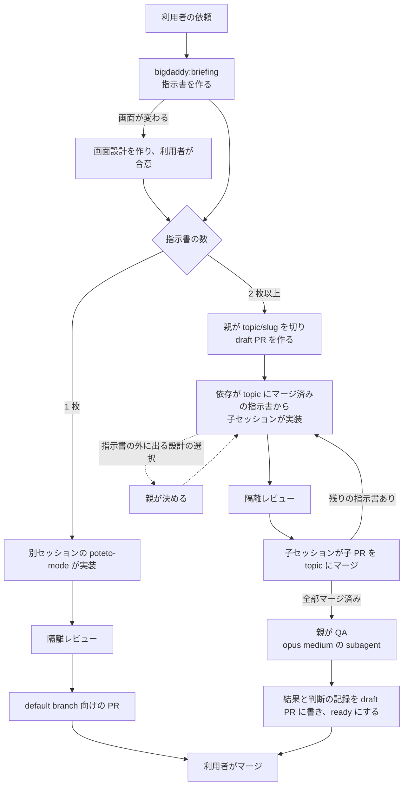

# 作業の流れ

bigdaddy が依頼を受けてから PR が返ってくるまでの規則と、skill の役割をまとめる。概要は [README](../README.md) にある。

## 全体の流れ

## 規則

- 前段（依頼を十分で本質的な指示書にする）は `bigdaddy:briefing`、後段（実装）は別セッションの pstack の `poteto-mode`。
- pstack の skill はほぼ全部（`setup-pstack` 以外）が `disable-model-invocation: true` で、モデルは Skill ツールで起動できない。`SKILL.md` を Read ツールで読んで従う。利用者が打つときは `/pstack:<name>`。bigdaddy の skill と yomiyasu は Skill ツール。
- 大きい作業（指示書が 2 枚以上）は、親が default branch（例: main）から `topic/<slug>` を切り、子セッションが隔離レビュー済みの PR を自分で topic にマージする。親は、topic を切るときに topic から default branch への PR を draft で作る。各指示書の依存（同じファイルを触るものを含む）は draft PR の一覧に書き、依存がすべて topic にマージ済みの指示書だけを始める。子が全部マージされたら、親が opus medium の subagent で QA を回す。親は、その結果と子の「判断の記録」を draft PR に書いて ready にする。利用者がその PR だけを確かめてマージする。指示書が 1 枚なら default branch 向けの PR 1 本で、利用者がマージする。
- 実装セッションが利用者に聞く項目は `briefing` の「本人に必ず返すもの」の 1 か所にある（default branch へのマージ、本番データへの書き込み、指示書に無い外部送信・feature flag、方針の転換）。外部送信と feature flag は、指示書を作る段階で決める。
- 画面が変わる依頼は、指示書を渡す前に画面設計を作って利用者が合意する。道具は作業リポジトリの指定が先で、無ければ Claude Design。実装役は画面設計を見た目と操作の正本にし、QA が画面設計と実装の画面を照合する。文言・色などの値の差し替えだけの変更は除く。
- 設計や全体の方針を決める意思決定と、目的との照合は、親（briefing）が子に渡す前に済ませる。指示書の「設計」で、実装役が設計の選択をせずに進められる状態にする。指示書の外に出る設計の選択（手段の変更、他の指示書への影響、画面設計との差）は、子が親の id に `SendMessage` で返し、親が決める。
- 隔離レビューの回ごとの範囲は `review-triage-loop` の `references/isolated-review.md` の「回ごとの範囲」に、2 回目以降の blocking を親に送って仕分ける流れは `review-triage-loop` の「2 回目以降の blocking」にある。
- briefing は利用者の代理として質問を減らし、poteto-mode が着手に必要な項目を埋めた指示書を作る。
- pstack と yomiyasu（日本語の文章の推敲）は依存として一緒に入る。どちらも `marketplace.json` で sha を固定している。

## 実装セッションの主のモデル

実装セッションの主のモデルは、[モデル表](setup.md#モデル表と-subagent-のモデル)ではなく briefing が指示書の推奨モデルで決める（jev-gates の `route-model.sh --session <playbook>`）。Feature・Refactoring は設計が指示書で決まっているので `sonnet high`、原因が未確定の Bug fix・Perf issue などは `opus medium`。sonnet の主は、完了の判定が要る場面を `opus medium` の subagent に出す。指示書の外に出る設計の選択は親に返す。subagent には `model` と `effort` を Agent の引数で渡す。

## skill の役割

| skill | 役割 |
|---|---|
| `briefing` | 前段。形を問わず依頼を受け、指示書の空欄を観察・代理回答・質問の順で埋め、必要なときだけなぜなぜ分析で原因を特定して、poteto-mode 向けの指示書で別セッションへ渡す。コードは書かない。代理回答の既定は `references/proxy-answers.md`。手元の `~/.claude/bigdaddy/proxy-answers.md` があれば、そちらを優先して読む |
| `jev-gates` | 分岐・絞り込み・完了判定を Jev で決める手順と `scripts/jev.sh` |
| `review-triage-loop` | 外部レビューの指摘を Jev で仕分け、設計に昇華して直す。隔離レビューの回数と範囲も決める |
| `agent-reasoning-playbook` | 推論・検証・分解・メタ認知のチェックリスト |
| `logic-audit` | 主張と推論を形式論理で検査し、根拠の強さどおりの論証を組む。決定モードでは、作業中の意思決定を 4 項目の記録と 1 回の Jev リクエストで点検する |
| `usage-report` | 会話ログから skill・プレイブック・原則・Jev・subagent の使用回数と、モデル・本体か subagent か・agent の種類ごとのトークン数を集計する。改善点を探すときに使う |
